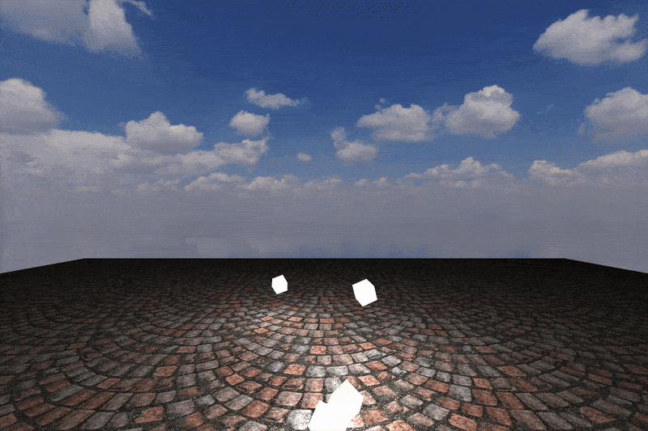

# COMP 371 - Assignment 2: Interactive 3D Graphics Scene 

- Created by Jeremy Crete, Colton Leblond and Charles Eimer  
- Concordia University - Summer 2025  
- Course: COMP 371 - Computer Graphics

## Table of Contents

- [Badges](#badges)
- [Features Overview](#features-overview)
- [Assignment Requirements Checklist](#assignment-requirements-checklist)
  - [Libraries Used](#libraries-used)
  - [Interactive Camera](#inetractive-camera)
  - [Scene Content](#scene-content)
  - [Advanced Features](#advanced-features-choose-1-for-this-assignment-and-implement-the-other-next-assignment)
- [Demo Assignment 1](#demo-assignment-1)
- [Demo Assignment 2](#demo-assignment-2)
- [Controls](#controls)
- [Credits](#credits)

## Badges

## Features Overview

This project implements a 3D scene using OpenGL. It features interactive camera movement, multiple textures and dynamic lighting with multiple light sources.

## Assignment Requirements Checklist

### Libraries Used
- [X] OpenGL
- [X] GLFW
- [X] GLM
- [X] GLEW
- [X] stb_image.h
- [X] Assimp (Model loading)

### Inetractive Camera
- [X] Mouse controlled rotation to change the viewing direction of the scene
- [X] Keyboard controlled translation (WASD style)
- [X] Movement is relative to the camera
- [X] Orbit mode (toggle using F) 

### Scene Content
- [X] Multiple Textured surfaces (ex: Skybox, Ground, Cubes)
- [X] 3D model Loading using Assimp

### Dynamic lighting
- [X] Two moving directional lights
- [X] Phong lighting model
- [X] Shadow mapping for both lights
- [X] Toggle on off at run time for 1 of the lights

### Hierarchical Animation
- [X] During Burnout mode 2 degrees of motion can be seen with the entire car spinning and the wheels spinning

### Additional Interactions / Creativity
- [X] Texture "wraps": **1 = Onyx**, **2 = Gold**
- [X] **Konami Code** (`Up, Up, Down, Down, Left, Right, Left, Right, B, A`) toggles the secret **RGB** wrap
- [X] **Particle system**: back wheels emit smoke to create a burnout/donuts effect
- [X] **Second Shadow**: toggles with **L**
- [X] Window Title acts as makeshift HUD

## Demo Assignment 1

## Demo Assignment 2

## Controls

| Actions         | Key / Input         |
|-----------------|---------------------|
| Move Forward        | `W`                |
| Move Backward       | `S`                |
| Move Left           | `A`                |
| Move Right          | `D`                |
| Increase Movement Speed          | `SHIFT`                |
| Look Around         | Mouse movement     |
| Exit Program        | `ESC`              |

## Credits
- [Cloud Texture / Skybox](https://polyhaven.com/a/kloofendal_48d_partly_cloudy_puresky)
- [Cybertruck Model](https://sketchfab.com/3d-models/low-poly-tesla-cybertruck-64b4af3ab92543d297992ac4c2f8ed96)

